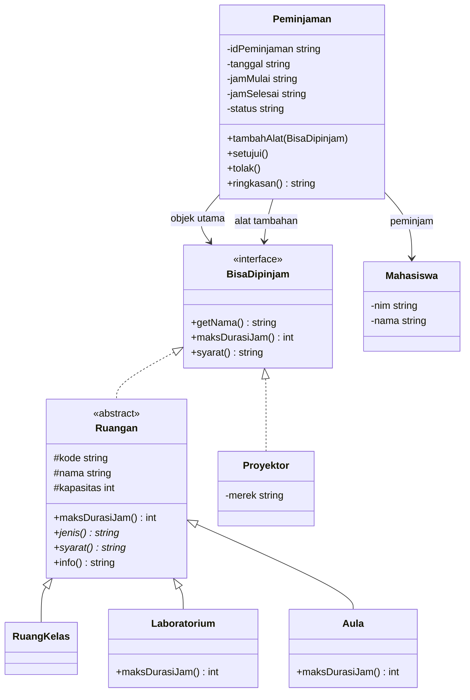

# Mini Application OOP: Sistem Peminjaman Ruangan Kampus


| | |
|---|---|
| **Nama** | Rizki Maulana |
| **NIM** | 2025102246 |

## Masalah

Mahasiswa kesulitan mengetahui ruangan yang tersedia dan harus meminjam secara manual, sehingga jadwal penggunaan ruangan bisa bentrok.

Pada tahap ini fokusnya adalah model OOP-nya. Setiap jenis ruangan punya aturan berbeda (batas durasi dan syarat), dan alat pendukung seperti proyektor juga ikut dipinjam. Sistem harus memperlakukan semuanya secara seragam tanpa `if/else` berdasarkan jenis, supaya mudah ditambah jenis baru.

## Cara Menjalankan

**Lewat terminal**

```bash
php 2025102246_rizkimaulana_pbo_p5.php
```

**Lewat XAMPP**

1. Simpan file `.php` di folder `htdocs`.
2. Jalankan Apache.
3. Buka `http://localhost/<nama-folder>/2025102246_rizkimaulana_pbo_p5.php`.

## Desain

### Kandidat Class

| Class / Interface | Jenis | Peran |
|---|---|---|
| `BisaDipinjam` | Interface | Kontrak: `getNama()`, `maksDurasiJam()`, `syarat()` |
| `Ruangan` | Abstract class | Induk semua ruangan (kode, nama, kapasitas, `info()`); batas durasi bawaan 4 jam |
| `RuangKelas` | Subclass `Ruangan` | Memakai batas durasi bawaan |
| `Laboratorium` | Subclass `Ruangan` | Override batas durasi menjadi 3 jam |
| `Aula` | Subclass `Ruangan` | Override batas durasi menjadi 8 jam |
| `Proyektor` | Class (implements) | Alat pendukung dengan batas durasi 6 jam |
| `Mahasiswa` | Class | Pihak yang meminjam (nim, nama) |
| `Peminjaman` | Class | Transaksi; tersusun dari `Mahasiswa`, objek utama, dan alat tambahan |

### Diagram Class



### Relasi dan Alasan Pemilihannya

| Relasi | Penerapan | Alasan |
|---|---|---|
| **Inheritance** (is-a) | `RuangKelas`, `Laboratorium`, dan `Aula` extends `Ruangan` | Ketiganya memang ruangan dan berbagi kode, nama, kapasitas, serta `info()`. Yang berbeda hanya aturan durasi dan syaratnya. |
| **Interface** (can-do) | `Ruangan` dan `Proyektor` implements `BisaDipinjam` | `Proyektor` bukan ruangan sehingga tidak cocok diwariskan, tetapi sama-sama bisa dipinjam. Interface membuat `Peminjaman` bekerja dengan kemampuan "bisa dipinjam", bukan dengan class tertentu. |
| **Composition** (has-a) | `Peminjaman` memiliki `Mahasiswa`, objek utama, dan array alat tambahan | `Peminjaman` bukan sejenis `Mahasiswa` atau `Ruangan`, ia hanya memakai keduanya. Dengan composition, komponennya mudah diganti atau ditambah. |

### Overriding dan Polymorphism

`Ruangan` menyediakan `maksDurasiJam()` bawaan 4 jam. `Laboratorium` meng-override-nya menjadi 3 jam dan `Aula` menjadi 8 jam (**overriding**).

Method private `cekDurasi(BisaDipinjam $objek)` pada `Peminjaman` cukup memanggil `$objek->maksDurasiJam()`. Aturan yang dipakai otomatis mengikuti objek yang diperiksa, baik `Laboratorium`, `Aula`, maupun `Proyektor`, tanpa `if/else` berdasarkan nama class (**polymorphism**). Jika nanti ada `RuangRapat`, cukup buat subclass baru tanpa mengubah `Peminjaman`.

### Abstraction

`Ruangan` dibuat abstract karena "ruangan umum" tidak punya arti sendiri. Method `jenis()` dan `syarat()` wajib diwujudkan subclass, dan `new Ruangan(...)` ditolak oleh PHP.

## Contoh Output

Tampilan di browser (XAMPP):


Versi teks:

```text
=== DEMO POLYMORPHISM: satu kontrak BisaDipinjam, banyak perilaku ===
- A101                       | maks 4 jam | Pengajuan cukup lewat sistem
- Lab Komputer               | maks 3 jam | Wajib didampingi laboran dan membawa surat pengantar dosen
- Aula Utama                 | maks 8 jam | Wajib melampirkan proposal kegiatan dan izin kemahasiswaan
- Proyektor Epson EB-X06     | maks 6 jam | Dikembalikan ke petugas setelah dipakai

=== PENGUJIAN MINI APPLICATION ===

Skenario 1: Alur normal: Lab 2 jam + proyektor, lalu disetujui
  [P001] Budi meminjam Lab Komputer pada 2026-10-26 pukul 09:00-11:00 (status: disetujui)
    Alat tambahan: Proyektor Epson EB-X06
  HASIL: OK

Skenario 2: Batas durasi aula (8 jam) masih diterima
  [P002] Sari meminjam Aula Utama pada 2026-10-27 pukul 08:00-16:00 (status: menunggu)
  HASIL: OK

Skenario 3: Lab 4 jam melebihi batas lab (3 jam)
  Pesan: Lab Komputer maksimal 3 jam per peminjaman
  HASIL: OK (ditolak sesuai harapan)

Skenario 4: Aula 8 jam + proyektor melebihi batas proyektor (6 jam)
  Pesan: Proyektor Epson EB-X06 maksimal 6 jam per peminjaman
  HASIL: OK (ditolak sesuai harapan)

Skenario 5: Abstract class Ruangan tidak boleh dibuat langsung
  Pesan: Cannot instantiate abstract class Ruangan
  HASIL: OK (ditolak sesuai harapan)

Skenario 6: Objek yang bukan BisaDipinjam ditolak oleh kontrak
  Pesan: Peminjaman::tambahAlat(): Argument #1 ($alat) must be of type BisaDipinjam, Mahasiswa given
  HASIL: OK (ditolak sesuai harapan)
```

## Skenario Pengujian

| No | Skenario | Hasil yang diharapkan |
|---|---|---|
| 1 | Lab 2 jam + proyektor, lalu disetujui | Diterima, status disetujui |
| 2 | Aula 8 jam (tepat di batas) | Diterima |
| 3 | Lab 4 jam (batas lab 3 jam) | Ditolak: Lab Komputer maksimal 3 jam |
| 4 | Aula 8 jam + proyektor (batas proyektor 6 jam) | Ditolak: Proyektor maksimal 6 jam |
| 5 | `new Ruangan(...)` langsung | Ditolak PHP: abstract class tidak bisa dibuat |
| 6 | Objek bukan `BisaDipinjam` dimasukkan sebagai alat | Ditolak PHP: harus bertipe `BisaDipinjam` |
